# الهيكل الإداري لمنصة شام — تحت مظلة الخبير شاهين

> ملف مولَّد تلقائياً من `src/utils/shaheenOrg.ts` — لا تعدله يدوياً. للتحديث: `node --import tsx scripts/shaheen-council/org-doc.mts`.

**فوق الهيكل كله: صاحب الموقع** — الوحيد اللي معاه الصلاحيات المطلقة (بيتعرف بحساب GitHub `spculculat-oss` والكود السري بس). أوامره من «مكتب صاحب الموقع» (`owner-control.yml`) ملزمة لشاهين وكل الروبوتات: وقف روبوت، فرامل الطوارئ، وحدود التطوير الذاتي.

كل روبوت وكل أداة ذكاء اصطناعي في المنصة لها مكان في الهيكل: **الخبير شاهين** المدير العام، **السكرتير** (مشرف شاهين) نائبه وقت الضغط، وخمس خلايا (أقسام) كل واحدة يرأسها كرسي في الاجتماع اليومي.

- **قبل الاجتماع بساعتين** (6:10 بتوقيت جرينتش = 8:10 الصبح بتوقيت القاهرة) كل أداة تعمل فحص شامل لنفسها: المشاكل، الإصلاح المقترح، وأفكار التطوير (`shaheen-precheck.yml`).
- **الاجتماع اليومي** (8:15 بتوقيت جرينتش = 10:15 الصبح بتوقيت القاهرة، بعد تجديد باقة الذكاء الاصطناعي اليومية) يناقش نتيجة الفحص كجدول أعمال (`shaheen-council.yml`).
- **أي روبوت جديد** لازم يتسجل هنا، وإلا الاختبارات تفشل (`tests/shaheenOrg.test.ts`).
- **كتيب الروبوتات** ([`SHAHEEN_HANDBOOK.md`](SHAHEEN_HANDBOOK.md)): سياسات الموقع وتوجهات المنصة وطرق التسعير والأدوات الإضافية — كل روبوت بيقراه، ونسخة مختصرة منه بتوصل لنموذج كل روبوت مع كل طلب.

## الخريطة

```mermaid
flowchart TB
  shaheen(["الخبير شاهين — المدير العام"])
  shaheen --- secretary
  subgraph leadership["القيادة"]
    direction TB
    state["دولة المنصة (أعلى سلطة بعد صاحب الموقع)"]
    owner_desk["مكتب صاحب الموقع (أوامره فوق الكل)"]
    platform_owner["وكيل ملك المنصة"]
    council["مجلس شاهين (الاجتماع اليومي)"]
    secretary["السكرتير — مشرف شاهين"]
    precheck["الفحص الشامل قبل الاجتماع"]
    patrol["الدورية بالتناوب (فحص وإصلاح ومراجعة خبير)"]
    finance["أمين شاهين — الإدارة المالية"]
    legal["المدير القانوني"]
    contracts["مسؤول التعاقدات"]
  end
  subgraph store["قسم المتجر والاستيراد"]
    direction TB
    scout["كشّاف المصادر"]
    importer["مستورد شاهين + مراجع الصفحات"]
    images["منظف الصور"]
    catalog["مدرّب كتالوج المتجر"]
    product_pages["فاحص صفحات المنتجات على الموبايل"]
    store_advisor["مستشار التسوق «اسأل شاهين»"]
  end
  shaheen --> store
  subgraph content["قسم المحتوى والظهور في البحث"]
    direction TB
    librarian["أمين مكتبة العطور"]
    news["نشرة الأخبار ودروس المساعد"]
    seo["منارة شاهين (الظهور في البحث)"]
    teacher["المعلم المحلي ومراجع الدروس"]
    researcher["باحث شاهين (المصادر المفتوحة)"]
  end
  shaheen --> content
  subgraph experience["قسم تجربة الزائر والتصميم واللغات"]
    direction TB
    chat["شات الخبير شاهين ومساعد شام"]
    library["مكتبة شاهين (رد بدون ذكاء اصطناعي)"]
    languages["وكيل اللغات — المترجم الذكي"]
    design_audit["تدقيق التصميم واللغات (مرتين في الأسبوع)"]
    design_expert["خبير التصميم متعدد التخصصات"]
    visitor_tour["جولة الزائر والمستشار الميداني"]
    inspect["فاحص إجابات شاهين"]
  end
  shaheen --> experience
  subgraph reliability["قسم الجودة والاعتماد على النفس"]
    direction TB
    school["مدرسة شاهين (الاعتماد على النفس)"]
    academy["أكاديمية شاهين (المدرسة على مدار الساعة)"]
    doctor["طبيب شاهين (الصيانة)"]
    verifier["المراجع الخارجي"]
    live_check["فحص شاهين على الموقع الحي"]
    keys["حارس مفاتيح الذكاء الاصطناعي"]
    intake["مستقبل تحديثات AI Studio"]
    studio_bridge["بوابة جوجل استوديو"]
    studio_zip["مستلم ملفات جوجل استوديو المضغوطة"]
    deploy["بناء ونشر الموقع"]
    chat_agent["وكيل البرمجة في الشات (منفّذ مهام شاهين)"]
    admin_agent["المساعد الإداري"]
  end
  shaheen --> reliability
  academy -.->|"كل ساعة فيها أسئلة باقية: الأكاديمية تشغّل المعلم المحلي يذاكر منهج خبراء المدرسة، والمراجع يراجع كل درس"| teacher
  academy -.->|"الدروس اللي عدّت المراجعة بتوصل لذاكرة شاهين، فوكيل شاهين يرد بيها على الزوار من غير أي منصة"| chat
  owner_desk -.->|"صاحب الموقع بيسلّم الدولة الموافقات أو يرجّعها لنفسه، وأي قرار ليها يقدر يرجّعه"| state
  state -.->|"الدولة بتوافق أو ترفض مهام المجلس (بتصويت أعضائها)"| council
  state -.->|"تعديلات الروبوتات المستنية موافقة ← الدولة تصوّت وتفحص وتدمج"| doctor
  state -.->|"الربط المباشر بين وكيل شاهين وشاهين تحت نظرها (S-10): كل رد مكتوب مصدره، وتقدر توقف الربط أو ترجّعه بأمر"| chat
  owner_desk -.->|"أوامر صاحب الموقع (إيقاف/تشغيل/فرامل) ← الاجتماع والمهام بتمشي عليها"| council
  owner_desk -.->|"حدود التطوير الذاتي ← التغيير الكبير يستنى موافقة صاحب الموقع"| doctor
  owner_desk -.->|"الروبوت الموقوف بأمره ← الدورية ماتشغلوش ولا تعتبره عطلان"| patrol
  platform_owner -.->|"كل تعديل له يقرّه تصويت دولة المنصة قبل النزول، وهو خاضع لرقابتها"| state
  platform_owner -.->|"أوامر صاحب الموقع فوق أوامره، ويقدر يرجّع أي قرار له في أي وقت"| owner_desk
  platform_owner -.->|"يتلقى مهام التطوير من مجلس شاهين وينفّذها مثل وكيل البرمجة في الشات"| council
  librarian -.->|"شاهين يراجع موضع المكتبة وتطويرها؛ الفهرسة محلية عند الطلب"| council
  librarian -.->|"قائمة دراسة داخلية فقط؛ لا تتحول المراجع إلى معرفة متعلمة دون اطلاع قانوني ومراجعة موثقة، ولا تعرض ملاحظاتها للزوار"| school
  legal -.->|"يراجع حقوق المصادر والاقتباس والترجمة لكل نسخة قبل النشر؛ لا تعتبر الخطة أو الفحص الآلي موافقة قانونية"| librarian
  languages -.->|"تعريب بيانات الفهرس دون ادعاء ترجمة الكتب"| librarian
  finance -.->|"حالة الفحص المنقحة فقط؛ الأرقام والطلبات تبقى خاصة"| secretary
  finance -.->|"تصعيد أعطال الدفع والتسجيل للمراجعة دون أسرار أو تحويل أموال"| council
  keys -.->|"جاهزية إعدادات الخادم؛ اعتماد الحساب قرار صاحب المتجر"| finance
  patrol -.->|"مشكلة ماتصلحتش ولا شاهين حلها ← مهمة تطوير"| council
  patrol -.->|"تقييم الدورية بالتناوب ← مادة للمشرف"| secretary
  patrol -.->|"الخادم أو الموقع واقع ← كشف وصيانة"| doctor
  patrol -.->|"صفحات قديمة أو واقعة ← إعادة نشر"| deploy
  precheck -.->|"تقارير كل الأدوات = جدول أعمال الاجتماع"| council
  legal -.->|"القرارات القانونية ملزمة — الاجتماع مايقترحش تجاوزها"| council
  legal -.->|"نقل المنتجات بإذن مكتوب من المورد بس (L-03)"| importer
  legal -.->|"معايير رسائل واتفاقية التعاقد (L-40)"| contracts
  contracts -.->|"المتاجر الموقّعة والمعتمدة بس ← يتنقل منها (L-03)"| importer
  legal -.->|"إفصاح الذكاء الاصطناعي من غير أسماء المزودين"| chat
  secretary -.->|"ينوب عن شاهين وقت الضغط"| council
  council -.->|"متاجر يفحصها"| scout
  council -.->|"أسئلة يذاكرها"| school
  secretary -.->|"توجيهات جودة للردود"| chat
  secretary -.->|"تقييم وتوجيهات"| seo
  scout -.->|"متجر موثوق جديد ← ينقل منتجاته"| importer
  importer -.->|"صور منتجات جديدة ← تنظيفها"| images
  importer -.->|"منتجات جديدة ← تصحيح البيانات والنوتات"| catalog
  catalog -.->|"أوصاف أقوى ← ظهور أفضل في البحث"| seo
  seo -.->|"صفحات ضعيفة في البحث ← تحسين أوصافها"| catalog
  product_pages -.->|"صفحة منتج مكسورة ← المراجع يخفيها"| importer
  news -.->|"دروس جديدة ← مادة للمذاكرة"| school
  school -.->|"ذاكرة شاهين ← رد بدون ذكاء اصطناعي وقت الضغط"| chat
  school -.->|"مهارات قراءة صفحات المتاجر بدون ذكاء اصطناعي"| importer
  design_audit -.->|"اللغات نص المترجمة تتترجم الأول + أماكن النصوص الإنجليزي الثابتة"| languages
  languages -.->|"تقرير الترجمة والفئات اللي مش بتنعكس يمين/شمال ← التدقيق الجاي يتأكد"| design_audit
  design_audit -.->|"تدقيق التصميم يمد الخطط بملاحظات التباين والاستجابة والموبايل"| design_expert
  languages -.->|"توطين المحتوى واتجاه RTL والحزم اللغوية"| design_expert
  visitor_tour -.->|"ملاحظات رحلة المستخدم الفعلية على الهاتف"| design_expert
  catalog -.->|"حقائق المنتج المعتمدة للتصاميم التي تستخدم منتجاً محدداً"| design_expert
  design_expert -.->|"تقييم شاهين ومقترحات التحسين متعددة التخصصات تدخل الاجتماع اليومي"| council
  precheck -.->|"مشاكل الفحص الشامل ← المستشار الميداني يتأكد منها على الموقع الحي"| visitor_tour
  visitor_tour -.->|"رأي واقتراحات المستشار الميداني + خطوات الشراء الواقعة ← بنود في الاجتماع"| council
  visitor_tour -.->|"صفحات منتجات أو صور مكسورة"| product_pages
  verifier -.->|"مهمة اتقفلت ولسه مش متصلحة ← تتفتح تاني"| council
  languages -.->|"لغة وأرقام صحيحة للزائر"| chat
  live_check -.->|"شاهين مش بيرد على الموقع ← كشف وصيانة"| doctor
  doctor -.->|"إصلاح ← إعادة نشر"| deploy
  keys -.->|"باقات خلصت ← السكرتير يمسك الاجتماع"| secretary
  studio_zip -.->|"نفس فلتر البوابة للملفات المضغوطة"| studio_bridge
  studio_bridge -.->|"كل تحديث بيعدي من البوابة بيتراجع تاني بعد النشر"| intake
  studio_bridge -.->|"تعديلات الاستوديو السليمة ← نشر الموقع"| deploy
  intake -.->|"تحديث سليم ← ينزل على الموقع"| deploy
  inspect -.->|"ردود ضعيفة ← توجيهات جودة"| secretary
  library -.->|"المحركات واقعة ← رد من الموسوعة والدروس والذاكرة بمصدره"| chat
  researcher -.->|"سؤال جديد مش في المكتبة ← خلاصة المصادر المفتوحة بروابطها"| chat
  chat -.->|"سؤال ماتجاوبش من محرك ← على قائمة المذاكرة"| school
  school -.->|"الدروس والذاكرة ← مادة المكتبة"| library
  researcher -.->|"خلاصة المصادر ← مراجع للدرس"| teacher
  teacher -.->|"دروس مراجَعة من غير مفتاح ← ذاكرة شاهين"| school
  council -.->|"مهمة تطوير مفتوحة ← الوكيل ينفذها ويقفلها بـ PR"| chat_agent
  patrol -.->|"عطل ماتصلحش لوحده ← مهمة تطوير للوكيل"| chat_agent
  verifier -.->|"مهمة اتقفلت ولسه بايظة ← تتنفذ تاني بمراجعة الوكيل"| chat_agent
  chat_agent -.->|"إصلاح اتدمج ← نشر الموقع بالنسخة الجديدة"| deploy
  chat_agent -.->|"اللي اتعمل واللي مستني موافقة التاجر ← مادة للمشرف"| secretary
  chat_agent -.->|"عطل بيظهر على الموقع الحي ← كشف وصيانة"| doctor
  legal -.->|"مصادر رسمية مفتوحة بس وذكر المصدر (CC BY-SA) — مافيش قراءة لصفحات نتائج جوجل"| researcher
```

## السكرتير — مشرف شاهين

- يجهز جدول أعمال الاجتماع من الفحص الشامل (قبل الاجتماع بساعتين).
- يرأس الاجتماع بدل شاهين لو مفيش محرك ذكاء اصطناعي، أو الباقات خلصت، أو شاهين ما ردش، أو الضغط عالي.
- ينفذ القرارات الآمنة بس (تشغيل روبوت، سؤال للمدرسة، متجر للكشّاف) ويحوّل الباقي لمهام.
- يوزع طلبات المساعدة بين الأدوات.
- يسجل كل حاجة عملها بالنيابة، وشاهين يراجعها في أول اجتماع بعدها.

## القيادة

**الرئيس:** الخبير شاهين — المدير العام — يدير كل الأدوات، يرأس الاجتماع اليومي، يحدد أهداف التطوير ويوزع المهام.

| الأداة | المهمة | المواعيد | الروبوت | التقرير |
|---|---|---|---|---|
| دولة المنصة (أعلى سلطة بعد صاحب الموقع) | كل الروبوتات وشاهين والمجلس تحت رقابتها، وبيرجعولها في كل الموافقات: كل ساعة أعضاؤها (شاهين، المدير القانوني، الأمن والخصوصية، الجودة، المالية، ورئيس القسم المختص) بيصوّتوا على مهام المجلس وتعديلات الروبوتات المستنية موافقة. القرار لا مركزي بالتصويت، وللقانوني والأمن «فيتو»؛ اللي يتوافق عليه بيعدّي كل الفحوص وبعدين ينزل، واللي يترفض بيروح لصاحب الموقع بالأسباب. عندها كل الصلاحيات ما عدا بيانات صاحب الموقع ومفاتيحه وغرفته ومفاتيح تحكمه، وخاضعة لأوامره في أي وقت (يرجّع الموافقات لنفسه، يوقفها، أو يرجّع أي قرار ليها). | يومياً | `platform-state.yml` | `platform-state.json` |
| مكتب صاحب الموقع (أوامره فوق الكل) | ينفذ أوامر صاحب الموقع وحده (حسابه على GitHub بس): يوقف أي روبوت أو يرجعه، يوقف كل الروبوتات بفرامل الطوارئ، ويختار نظام التطوير الذاتي (التصليحات الصغيرة الآمنة تلقائي، أو كل تغيير يستنى موافقته). كل روبوت بيسأل المكتب قبل ما يشتغل، وكل أمر بيتسجل في سجل مايتمسحش. ومعاه «جناح صاحب الموقع» و«غرفة شاهين الخاصة» (صاحب الموقع وشاهين والسكرتير بس، متشفرة على جهازه). وبينفذ كل اللي صاحب الموقع يوافق عليه من «صندوق الموافقات» (تعديلات شاهين، أوامره للروبوتات، تعديلات الروبوتات ومهام المجلس) بعد ما يعدّي كل الفحوص، ويرجّع أي حاجة بزرار «رجّع». | عند الطلب / مع كل تعديل | `owner-control.yml` | — |
| وكيل ملك المنصة | وكيل مثل وكيل البرمجة في الشات: ينفّذ مهام شاهين والصيانة والتطوير، ويدير المنصة نيابة عن صاحب الموقع تحت رقابة دولة المنصة، وكل تعديل له يقرّه تصويت الدولة قبل النزول، وهو خاضع لأوامر صاحب الموقع في أي وقت. | عند الطلب / مع كل تعديل | — | — |
| مجلس شاهين (الاجتماع اليومي) | يجمع رؤساء الأقسام كل يوم 10:15 الصبح (بعد تجديد باقة الذكاء الاصطناعي)، يكتب المحضر، ينفذ الآمن ويحوّل الباقي لمهام تطوير. | يومياً | `shaheen-council.yml` | `shaheen-council.json` |
| السكرتير — مشرف شاهين | يقيس كل أداة ذكاء اصطناعي ويكتب لها توجيهات، يجهز جدول الأعمال، وينوب عن شاهين في الاجتماع وقت الضغط أو لو مفيش محرك ذكاء اصطناعي. | كل 12 ساعات | `shaheen-news.yml` | `ai-supervisor.json` |
| الفحص الشامل قبل الاجتماع | قبل الاجتماع بساعتين: كل روبوت يفحص نفسه ويكتب مشاكله والإصلاح المقترح وأفكار التطوير، والسكرتير يوزع طلبات المساعدة بين الأدوات. | يومياً | `shaheen-precheck.yml` | `shaheen-precheck.json` |
| الدورية بالتناوب (فحص وإصلاح ومراجعة خبير) | تلات ورديات بالتناوب، وردية كل ساعة. الدورية تراجع تقارير وحالة كل دور حسب ورديته، وتجري الاختبارات العملية المحددة لنطاقه كل 3 ساعات من غير ضغط على الموقع. الأدوار الاستشارية اللي مالهاش سير عمل تراقَب من التقارير وتقييم مشرف شاهين ومش بتتشغل تلقائياً. الإصلاحات الآمنة تتعمل، والباقي يروح لشاهين أو لفريق عمل، وكل تشغيل مكتمل يراجعه خبير من نفس النطاق. | كل 2 ساعات | `shaheen-patrol.yml` | `shaheen-patrol.json` |
| أمين شاهين — الإدارة المالية | تحصيل موثّق وتقارير يومية وأسبوعية وشهرية ومراجعة الدفع. التفاصيل داخل لوحة مالية خاصة؛ التقرير العام يحتوي حالة الفحص المنقحة من المشرف فقط. لا تحويلات أو استردادات أو اعتماد حسابات تلقائياً. | يومياً | `shaheen-finance.yml` | `ai-supervisor.json` |
| المدير القانوني | يراجع امتثال المنصة للقوانين؛ قراراته ملزمة لشاهين وكل الأدوات، ومحدش يتجاوزها لحد ما المدير القانوني نفسه يغيرها (مثال: وقف نقل المنتجات لحد إذن المورد المكتوب). | عند الطلب / مع كل تعديل | — | — |
| مسؤول التعاقدات | يجهز رسائل التعاون مع أصحاب المتاجر (يبعتها عضو من الفريق باسمه الحقيقي)، ويدير الموافقة الإلكترونية على الاتفاقية، ومايفتحش متجر للنقل غير بعد توقيعه واعتماد المدير القانوني (L-40). الهامش مايتكشفش، ورابط المتجر بعد الموافقة بس. | عند الطلب / مع كل تعديل | — | — |

## قسم المتجر والاستيراد

**الرئيس:** خبير المتجر والاستيراد — متاجر موثوقة من العالم، منتجات كاملة بصور نظيفة وأسعار صحيحة (+50% + الشحن)، وصفحات منتجات سليمة.

| الأداة | المهمة | المواعيد | الروبوت | التقرير |
|---|---|---|---|---|
| كشّاف المصادر | يدوّر على متاجر عطور موثوقة في العالم كله ويراجع سيرتها الذاتية قبل ما تدخل. | كل 6 ساعات | `shaheen-discover.yml` | `import-sources.json` |
| مستورد شاهين + مراجع الصفحات | ينقل منتجات المتاجر المقبولة ويسعّرها ويراجع كل صفحة ويخفي المعيب. | كل 2 ساعات | `shaheen-import.yml` | `store-review.json` |
| منظف الصور | يشيل أرقام وروابط المورد من صور المنتجات. | كل 2 ساعات | `shaheen-import.yml` | `image-clean.json` |
| مدرّب كتالوج المتجر | يصحح الأسماء والأوصاف ويضيف العائلة العطرية والنوتات والمواسم. | كل 12 ساعات | `shaheen-news.yml` | `store-catalog.json` |
| فاحص صفحات المنتجات على الموبايل | يفتح صفحات المنتجات على الموقع الحقيقي زي زائر على الموبايل ويتأكد إنها سليمة. | يومياً | `product-pages-check.yml` | — |
| مستشار التسوق «اسأل شاهين» | يختار للزائر من منتجات المتجر الحقيقية حسب طلبه. | عند الطلب / مع كل تعديل | — | — |

## قسم المحتوى والظهور في البحث

**الرئيس:** خبير المحتوى والظهور في البحث — أخبار حقيقية، دروس، أوصاف قوية، وظهور الموقع في محركات البحث.

| الأداة | المهمة | المواعيد | الروبوت | التقرير |
|---|---|---|---|---|
| أمين مكتبة العطور | ينظم خطط التأليف المستقل وسجلات الأدلة؛ الاعتماد العلمي والقانوني واعتماد شاهين مطلوبون لكل نسخة قبل النشر. مساعد محلي عند الطلب لفهرسة مراجع العطور وتصنيفها والبحث فيها وتصدير بياناتها. موضعه مبدئي تحت إشراف شاهين؛ لا يرفع كتباً محمية ولا يدّعي وجود نسخ أو ترجمات دون ترخيص. | عند الطلب / مع كل تعديل | — | — |
| نشرة الأخبار ودروس المساعد | أخبار العطور الحقيقية كل 12 ساعة، ودروس لمساعد شام عن الأسئلة اللي مالقاش لها إجابة. | كل 12 ساعات | `shaheen-news.yml` | `shaheen-news.json` |
| منارة شاهين (الظهور في البحث) | يفحص الموقع زي محركات البحث، يكتب العناوين والأوصاف ويرسل الصفحات للفهرسة. | كل 6 ساعات | `shaheen-seo.yml` | `seo-agent.json` |
| المعلم المحلي ومراجع الدروس | نموذج ذكاء اصطناعي مفتوح (Qwen2.5-7B، رخصة Apache-2.0) شغال على GitHub نفسه من غير مفتاح ولا حساب: يكتب لمدرسة شاهين دروس الأسئلة الناقصة من مراجع المكتبة والمصادر المفتوحة، ومراجع صارم يرفض أي درس فيه معلومة غلط أو نصيحة مش آمنة قبل ما يتحفظ. | كل 6 ساعات | `shaheen-discover.yml` | `shaheen-school.json` |
| باحث شاهين (المصادر المفتوحة) | منظومة بحث عنكبوتية موجهة عند الطلب: بحث متوازي، ذاكرة مؤقتة للمستندات العامة لمدة ربع ساعة، دمج الطلبات المتكررة وحدود للتزامن والحجم؛ لا زحف شامل ولا حفظ لأسئلة الزوار. سؤال جديد مش في الذاكرة ولا المكتبة: يدور في ويكيبيديا من الواجهة الرسمية المجانية، يقرا المقالات ويقارنها ويرد بالخلاصة والمصادر (CC BY-SA)، ويدي المدرسة نفس الخلاصة كمراجع. مايبحثش عن الأخبار والأسعار والأسئلة الشخصية، ومايقراش صفحات نتائج جوجل. | عند الطلب / مع كل تعديل | — | — |

## قسم تجربة الزائر والتصميم واللغات

**الرئيس:** خبير تجربة الزائر والتصميم واللغات — ما يراه الزائر: الشات، اللغات المئة، الأرقام، التصميم على الموبايل.

| الأداة | المهمة | المواعيد | الروبوت | التقرير |
|---|---|---|---|---|
| شات الخبير شاهين ومساعد شام | يرد على الزوار بـ«وكيل شاهين» المربوط بيه مباشرة تحت نظر دولة المنصة (S-10): يقرا السؤال مع الكلام اللي قبله، وسؤال الشراء بيرد عليه من منتجات المتجر نفسها (السعر والحجم والمكونات وليه كل واحد مناسب والربط بينهم)، والتركيبة اللي يصممها بيقترح جنبها عطور المتجر القريبة منها؛ وبيفهم السؤال ومجاله ونوعه الأول، ويختار خبير المدرسة المناسب، ويقارن بين دروس الخبراء المراجَعة والمكتبة والإجابات المحفوظة والمصادر المفتوحة ويختار الأصح (الإجابة القديمة مصدر من المصادر مش الإجابة تلقائياً)، ولو مفيش معلومة أكيدة مايخمّنش ويبعت السؤال لخبير المجال في المدرسة يذاكره. | عند الطلب / مع كل تعديل | — | — |
| مكتبة شاهين (رد بدون ذكاء اصطناعي) | لما محركات الذكاء الاصطناعي تقع: يبني رد من موسوعة المواد الخام ودروس شاهين وأقرب سؤال في ذاكرته، مكتوب عليه مصدره، على السيرفر وفي متصفح الزائر. مايخمنش: الأخبار والأسعار والأسئلة الشخصية ليها الرد الصريح، وأسئلة الشراء لترشيحات المتجر. | عند الطلب / مع كل تعديل | — | — |
| وكيل اللغات — المترجم الذكي | يقيس اللغات المئة، ويترجم بالذكاء الاصطناعي كل نص لسه بالإنجليزي (فحص صارم + مراجعة محرك تاني)، ويبدأ باللغات اللي بلّغ عنها قسم التصميم ويحدد مكان النصوص الإنجليزي الثابتة في الكود. | كل 12 ساعات | `shaheen-languages.yml` | `shaheen-languages.json` |
| تدقيق التصميم واللغات (مرتين في الأسبوع) | وكيل خلفي يفتح الموقع بلغات مختلفة الأربع والسبت ويقيّم التصميم والترجمة. | كل 84 ساعة | `shaheen-manus.yml` | `manus-audit.json` |
| خبير التصميم متعدد التخصصات | يحوّل الموجز إلى خطة عبر تخصصات الهوية والجرافيك والواجهات والتغليف والتصوير والحركة والطباعة والإتاحة والخدمات والمنتجات، ويتعاون مع أدوار وتقارير برامج الذكاء المسجلة تحت شاهين؛ شاهين يراجع الجودة ويوجّه التحسين، ولا تُنفذ تغييرات أو ملفات نهائية تلقائياً. | عند الطلب / مع كل تعديل | — | — |
| جولة الزائر والمستشار الميداني | كل يوم بعد الفحص الشامل الوكيل الخلفي يتسوق من الموبايل زي الزبون: المتجر ← منتج ← السلة ← صفحة الدفع (من غير ما يدفع) ← سؤال لشاهين، وبعدين يبص على مشاكل الفحص في الموقع الحي ويقعد في الاجتماع «المستشار الميداني» برأيه واقتراحاته. | يومياً | `shaheen-manus.yml` | `manus-missions.json` |
| فاحص إجابات شاهين | يسأل شاهين أسئلة حقيقية ويفحص الرد (عند الطلب). | عند الطلب / مع كل تعديل | `shaheen-inspect.yml` | — |

## قسم الجودة والاعتماد على النفس

**الرئيس:** خبير الجودة والاعتماد على النفس — كل روبوت شغال، الموقع منشور وسليم، ومدرسة شاهين تخليه يرد لوحده لو كل الخدمات وقفت.

| الأداة | المهمة | المواعيد | الروبوت | التقرير |
|---|---|---|---|---|
| مدرسة شاهين (الاعتماد على النفس) | يمتحن شاهين نفسه ويذاكر ويحفظ في ذاكرته عشان يرد لوحده. | كل 6 ساعات | `shaheen-discover.yml` | `shaheen-school.json` |
| أكاديمية شاهين (المدرسة على مدار الساعة) | كل ساعة يشوف إيه الباقي على خبراء المدرسة السبعتاشر من منهجهم (من غير ذكاء اصطناعي)، ولو فيه شغل يشغّل المعلم المحلي على جهاز الروبوتات: كل خبير يذاكر أسئلة مجاله من مكتبة شاهين والمصادر المفتوحة، والمراجع الصارم يراجع كل درس بمعايير المجال وحدوده قبل ما يتحفظ في ذاكرة شاهين. لو مفيش حاجة باقية الساعة بتعدي من غير تشغيل، وماشي في نفس حارة الكشّاف عشان محدش يكتب في الذاكرة مع التاني. وكل ساعة كمان «حصّاد شاهين» يجهّز إجابات لأسئلة الزوار اللي ماتجاوبتش والأسئلة اليومية قبل ما الباقة تخلص (آخر ساعتين قبل التجديد من الباقي منها، وباقي اليوم من نماذج مفتوحة ليها حصة منفصلة) ويحفظ الكويس منها بس، عشان شاهين يرد منها لما المنصات تقف. | كل 1 ساعات | `shaheen-school-clock.yml` | `shaheen-school.json` |
| طبيب شاهين (الصيانة) | كل 10 دقايق يكشف على المنتجات والصور والمتجر والنشر. | عند الطلب / مع كل تعديل | `shaheen-doctor.yml` | — |
| المراجع الخارجي | الاتنين والخميس الوكيل الخلفي يراجع مهام التطوير اللي اتقفلت على الموقع الحي: اتصلحت فعلاً ولا لأ — اللي لسه بايظ يرجع للاجتماع. | كل 84 ساعة | `shaheen-manus.yml` | `manus-missions.json` |
| فحص شاهين على الموقع الحي | يكلم شاهين على الموقع الحقيقي كل يوم ويتأكد إنه بيرد. | يومياً | `live-smoke.yml` | — |
| حارس مفاتيح الذكاء الاصطناعي | يتأكد إن مفاتيح المحركات شغالة ويتابع الباقات اللي خلصت. | عند الطلب / مع كل تعديل | `shaheen-keys.yml` | `ai-quota.json` |
| مستقبل تحديثات AI Studio | يراجع كل تحديث جاي من AI Studio قبل ما ينزل. | عند الطلب / مع كل تعديل | `aistudio-intake.yml` | `aistudio-intake.json` |
| بوابة جوجل استوديو | كل نص ساعة ياخد تعديلات جوجل استوديو من مستودعه الخاص، يفلترها ويفحصها، وينشر السليم على الموقع — والباقي يستنى موافقة. | عند الطلب / مع كل تعديل | `aistudio-bridge.yml` | `aistudio-bridge.json` |
| مستلم ملفات جوجل استوديو المضغوطة | لما جوجل استوديو ما يقدرش يرفع، ياخد الملف المضغوط اللي التاجر رفعه في المسودة الخاصة، يفلتره بنفس قواعد البوابة، ويحط الصافي في فرع للمراجعة. | عند الطلب / مع كل تعديل | `aistudio-zip.yml` | — |
| بناء ونشر الموقع | يفحص ويبني وينشر الموقع على GitHub Pages مع كل تعديل. | عند الطلب / مع كل تعديل | `pages.yml` | — |
| وكيل البرمجة في الشات (منفّذ مهام شاهين) | يدخل من شات وكيل البرمجة لما التاجر يكتب «نفذ مهام شاهين»: يراجع مهام الاجتماع والدورية المفتوحة، ينفذها على فرع الجلسة، ويشغّل lint والاختبارات والبناء قبل أي دمج؛ وقبل أي مهمة كبيرة أو خطرة يستأذن التاجر. كمان بيعمل الصيانة الدورية للموقع ومراجعة أدوات الذكاء الاصطناعي اللي أداؤها بايظ (فشل تشغيل، تقرير مغلوط، بيانات ناقصة) ويصلحها من غير ما يخترع بيانات، ويرد على التاجر بالمصري من غير تفاصيل تقنية. | عند الطلب / مع كل تعديل | — | — |
| المساعد الإداري | تقارير الإدارة الذكية من أدوات قراءة فقط. | عند الطلب / مع كل تعديل | — | — |

## قرارات المدير القانوني (ملزمة لشاهين وكل الأدوات)

- **L-03** (مستورد شاهين + مراجع الصفحات): نقل منتجات جديدة من المتاجر متوقف بقرار المدير القانوني لحد ما يوصل إذن مكتوب من المورد؛ الكتالوج الحالي شغال ويتراجع عادي. الإذن بيوصل عن طريق «مسؤول التعاقدات»: المتجر اللي وقّع الاتفاقية إلكترونياً واعتمده المدير القانوني بس هو اللي يتنقل (L-40).
- **L-40** (مسؤول التعاقدات): التعاقد مع المتاجر بمعايير المدير القانوني C-01…C-10: الرسائل يبعتها عضو حقيقي من الفريق باسمه ومن غير إنكار استخدام الذكاء الاصطناعي، قيمة الهامش ماتتكشفش ومافيش كذب عنها، مافيش رابط للمتجر قبل الموافقة، وسطر لإيقاف المراسلة في أول رسالة، والاعتماد النهائي قبل النقل للمدير القانوني.
- **L-06** (شات الخبير شاهين ومساعد شام): كل رد ذكاء اصطناعي عليه إفصاح إنه مولد بالذكاء الاصطناعي، من غير ذكر أسماء المزودين للزوار.

الاجتماع اليومي مايقترحش تجاوز أي قرار منهم، والمدير القانوني بس هو اللي يرفعه.

## التعاون بين الأدوات

| من | إلى | ليه |
|---|---|---|
| أكاديمية شاهين (المدرسة على مدار الساعة) | المعلم المحلي ومراجع الدروس | كل ساعة فيها أسئلة باقية: الأكاديمية تشغّل المعلم المحلي يذاكر منهج خبراء المدرسة، والمراجع يراجع كل درس |
| أكاديمية شاهين (المدرسة على مدار الساعة) | شات الخبير شاهين ومساعد شام | الدروس اللي عدّت المراجعة بتوصل لذاكرة شاهين، فوكيل شاهين يرد بيها على الزوار من غير أي منصة |
| مكتب صاحب الموقع (أوامره فوق الكل) | دولة المنصة (أعلى سلطة بعد صاحب الموقع) | صاحب الموقع بيسلّم الدولة الموافقات أو يرجّعها لنفسه، وأي قرار ليها يقدر يرجّعه |
| دولة المنصة (أعلى سلطة بعد صاحب الموقع) | مجلس شاهين (الاجتماع اليومي) | الدولة بتوافق أو ترفض مهام المجلس (بتصويت أعضائها) |
| دولة المنصة (أعلى سلطة بعد صاحب الموقع) | طبيب شاهين (الصيانة) | تعديلات الروبوتات المستنية موافقة ← الدولة تصوّت وتفحص وتدمج |
| دولة المنصة (أعلى سلطة بعد صاحب الموقع) | شات الخبير شاهين ومساعد شام | الربط المباشر بين وكيل شاهين وشاهين تحت نظرها (S-10): كل رد مكتوب مصدره، وتقدر توقف الربط أو ترجّعه بأمر |
| مكتب صاحب الموقع (أوامره فوق الكل) | مجلس شاهين (الاجتماع اليومي) | أوامر صاحب الموقع (إيقاف/تشغيل/فرامل) ← الاجتماع والمهام بتمشي عليها |
| مكتب صاحب الموقع (أوامره فوق الكل) | طبيب شاهين (الصيانة) | حدود التطوير الذاتي ← التغيير الكبير يستنى موافقة صاحب الموقع |
| مكتب صاحب الموقع (أوامره فوق الكل) | الدورية بالتناوب (فحص وإصلاح ومراجعة خبير) | الروبوت الموقوف بأمره ← الدورية ماتشغلوش ولا تعتبره عطلان |
| وكيل ملك المنصة | دولة المنصة (أعلى سلطة بعد صاحب الموقع) | كل تعديل له يقرّه تصويت دولة المنصة قبل النزول، وهو خاضع لرقابتها |
| وكيل ملك المنصة | مكتب صاحب الموقع (أوامره فوق الكل) | أوامر صاحب الموقع فوق أوامره، ويقدر يرجّع أي قرار له في أي وقت |
| وكيل ملك المنصة | مجلس شاهين (الاجتماع اليومي) | يتلقى مهام التطوير من مجلس شاهين وينفّذها مثل وكيل البرمجة في الشات |
| أمين مكتبة العطور | مجلس شاهين (الاجتماع اليومي) | شاهين يراجع موضع المكتبة وتطويرها؛ الفهرسة محلية عند الطلب |
| أمين مكتبة العطور | مدرسة شاهين (الاعتماد على النفس) | قائمة دراسة داخلية فقط؛ لا تتحول المراجع إلى معرفة متعلمة دون اطلاع قانوني ومراجعة موثقة، ولا تعرض ملاحظاتها للزوار |
| المدير القانوني | أمين مكتبة العطور | يراجع حقوق المصادر والاقتباس والترجمة لكل نسخة قبل النشر؛ لا تعتبر الخطة أو الفحص الآلي موافقة قانونية |
| وكيل اللغات — المترجم الذكي | أمين مكتبة العطور | تعريب بيانات الفهرس دون ادعاء ترجمة الكتب |
| أمين شاهين — الإدارة المالية | السكرتير — مشرف شاهين | حالة الفحص المنقحة فقط؛ الأرقام والطلبات تبقى خاصة |
| أمين شاهين — الإدارة المالية | مجلس شاهين (الاجتماع اليومي) | تصعيد أعطال الدفع والتسجيل للمراجعة دون أسرار أو تحويل أموال |
| حارس مفاتيح الذكاء الاصطناعي | أمين شاهين — الإدارة المالية | جاهزية إعدادات الخادم؛ اعتماد الحساب قرار صاحب المتجر |
| الدورية بالتناوب (فحص وإصلاح ومراجعة خبير) | مجلس شاهين (الاجتماع اليومي) | مشكلة ماتصلحتش ولا شاهين حلها ← مهمة تطوير |
| الدورية بالتناوب (فحص وإصلاح ومراجعة خبير) | السكرتير — مشرف شاهين | تقييم الدورية بالتناوب ← مادة للمشرف |
| الدورية بالتناوب (فحص وإصلاح ومراجعة خبير) | طبيب شاهين (الصيانة) | الخادم أو الموقع واقع ← كشف وصيانة |
| الدورية بالتناوب (فحص وإصلاح ومراجعة خبير) | بناء ونشر الموقع | صفحات قديمة أو واقعة ← إعادة نشر |
| الفحص الشامل قبل الاجتماع | مجلس شاهين (الاجتماع اليومي) | تقارير كل الأدوات = جدول أعمال الاجتماع |
| المدير القانوني | مجلس شاهين (الاجتماع اليومي) | القرارات القانونية ملزمة — الاجتماع مايقترحش تجاوزها |
| المدير القانوني | مستورد شاهين + مراجع الصفحات | نقل المنتجات بإذن مكتوب من المورد بس (L-03) |
| المدير القانوني | مسؤول التعاقدات | معايير رسائل واتفاقية التعاقد (L-40) |
| مسؤول التعاقدات | مستورد شاهين + مراجع الصفحات | المتاجر الموقّعة والمعتمدة بس ← يتنقل منها (L-03) |
| المدير القانوني | شات الخبير شاهين ومساعد شام | إفصاح الذكاء الاصطناعي من غير أسماء المزودين |
| السكرتير — مشرف شاهين | مجلس شاهين (الاجتماع اليومي) | ينوب عن شاهين وقت الضغط |
| مجلس شاهين (الاجتماع اليومي) | كشّاف المصادر | متاجر يفحصها |
| مجلس شاهين (الاجتماع اليومي) | مدرسة شاهين (الاعتماد على النفس) | أسئلة يذاكرها |
| السكرتير — مشرف شاهين | شات الخبير شاهين ومساعد شام | توجيهات جودة للردود |
| السكرتير — مشرف شاهين | منارة شاهين (الظهور في البحث) | تقييم وتوجيهات |
| كشّاف المصادر | مستورد شاهين + مراجع الصفحات | متجر موثوق جديد ← ينقل منتجاته |
| مستورد شاهين + مراجع الصفحات | منظف الصور | صور منتجات جديدة ← تنظيفها |
| مستورد شاهين + مراجع الصفحات | مدرّب كتالوج المتجر | منتجات جديدة ← تصحيح البيانات والنوتات |
| مدرّب كتالوج المتجر | منارة شاهين (الظهور في البحث) | أوصاف أقوى ← ظهور أفضل في البحث |
| منارة شاهين (الظهور في البحث) | مدرّب كتالوج المتجر | صفحات ضعيفة في البحث ← تحسين أوصافها |
| فاحص صفحات المنتجات على الموبايل | مستورد شاهين + مراجع الصفحات | صفحة منتج مكسورة ← المراجع يخفيها |
| نشرة الأخبار ودروس المساعد | مدرسة شاهين (الاعتماد على النفس) | دروس جديدة ← مادة للمذاكرة |
| مدرسة شاهين (الاعتماد على النفس) | شات الخبير شاهين ومساعد شام | ذاكرة شاهين ← رد بدون ذكاء اصطناعي وقت الضغط |
| مدرسة شاهين (الاعتماد على النفس) | مستورد شاهين + مراجع الصفحات | مهارات قراءة صفحات المتاجر بدون ذكاء اصطناعي |
| تدقيق التصميم واللغات (مرتين في الأسبوع) | وكيل اللغات — المترجم الذكي | اللغات نص المترجمة تتترجم الأول + أماكن النصوص الإنجليزي الثابتة |
| وكيل اللغات — المترجم الذكي | تدقيق التصميم واللغات (مرتين في الأسبوع) | تقرير الترجمة والفئات اللي مش بتنعكس يمين/شمال ← التدقيق الجاي يتأكد |
| تدقيق التصميم واللغات (مرتين في الأسبوع) | خبير التصميم متعدد التخصصات | تدقيق التصميم يمد الخطط بملاحظات التباين والاستجابة والموبايل |
| وكيل اللغات — المترجم الذكي | خبير التصميم متعدد التخصصات | توطين المحتوى واتجاه RTL والحزم اللغوية |
| جولة الزائر والمستشار الميداني | خبير التصميم متعدد التخصصات | ملاحظات رحلة المستخدم الفعلية على الهاتف |
| مدرّب كتالوج المتجر | خبير التصميم متعدد التخصصات | حقائق المنتج المعتمدة للتصاميم التي تستخدم منتجاً محدداً |
| خبير التصميم متعدد التخصصات | مجلس شاهين (الاجتماع اليومي) | تقييم شاهين ومقترحات التحسين متعددة التخصصات تدخل الاجتماع اليومي |
| الفحص الشامل قبل الاجتماع | جولة الزائر والمستشار الميداني | مشاكل الفحص الشامل ← المستشار الميداني يتأكد منها على الموقع الحي |
| جولة الزائر والمستشار الميداني | مجلس شاهين (الاجتماع اليومي) | رأي واقتراحات المستشار الميداني + خطوات الشراء الواقعة ← بنود في الاجتماع |
| جولة الزائر والمستشار الميداني | فاحص صفحات المنتجات على الموبايل | صفحات منتجات أو صور مكسورة |
| المراجع الخارجي | مجلس شاهين (الاجتماع اليومي) | مهمة اتقفلت ولسه مش متصلحة ← تتفتح تاني |
| وكيل اللغات — المترجم الذكي | شات الخبير شاهين ومساعد شام | لغة وأرقام صحيحة للزائر |
| فحص شاهين على الموقع الحي | طبيب شاهين (الصيانة) | شاهين مش بيرد على الموقع ← كشف وصيانة |
| طبيب شاهين (الصيانة) | بناء ونشر الموقع | إصلاح ← إعادة نشر |
| حارس مفاتيح الذكاء الاصطناعي | السكرتير — مشرف شاهين | باقات خلصت ← السكرتير يمسك الاجتماع |
| مستلم ملفات جوجل استوديو المضغوطة | بوابة جوجل استوديو | نفس فلتر البوابة للملفات المضغوطة |
| بوابة جوجل استوديو | مستقبل تحديثات AI Studio | كل تحديث بيعدي من البوابة بيتراجع تاني بعد النشر |
| بوابة جوجل استوديو | بناء ونشر الموقع | تعديلات الاستوديو السليمة ← نشر الموقع |
| مستقبل تحديثات AI Studio | بناء ونشر الموقع | تحديث سليم ← ينزل على الموقع |
| فاحص إجابات شاهين | السكرتير — مشرف شاهين | ردود ضعيفة ← توجيهات جودة |
| مكتبة شاهين (رد بدون ذكاء اصطناعي) | شات الخبير شاهين ومساعد شام | المحركات واقعة ← رد من الموسوعة والدروس والذاكرة بمصدره |
| باحث شاهين (المصادر المفتوحة) | شات الخبير شاهين ومساعد شام | سؤال جديد مش في المكتبة ← خلاصة المصادر المفتوحة بروابطها |
| شات الخبير شاهين ومساعد شام | مدرسة شاهين (الاعتماد على النفس) | سؤال ماتجاوبش من محرك ← على قائمة المذاكرة |
| مدرسة شاهين (الاعتماد على النفس) | مكتبة شاهين (رد بدون ذكاء اصطناعي) | الدروس والذاكرة ← مادة المكتبة |
| باحث شاهين (المصادر المفتوحة) | المعلم المحلي ومراجع الدروس | خلاصة المصادر ← مراجع للدرس |
| المعلم المحلي ومراجع الدروس | مدرسة شاهين (الاعتماد على النفس) | دروس مراجَعة من غير مفتاح ← ذاكرة شاهين |
| مجلس شاهين (الاجتماع اليومي) | وكيل البرمجة في الشات (منفّذ مهام شاهين) | مهمة تطوير مفتوحة ← الوكيل ينفذها ويقفلها بـ PR |
| الدورية بالتناوب (فحص وإصلاح ومراجعة خبير) | وكيل البرمجة في الشات (منفّذ مهام شاهين) | عطل ماتصلحش لوحده ← مهمة تطوير للوكيل |
| المراجع الخارجي | وكيل البرمجة في الشات (منفّذ مهام شاهين) | مهمة اتقفلت ولسه بايظة ← تتنفذ تاني بمراجعة الوكيل |
| وكيل البرمجة في الشات (منفّذ مهام شاهين) | بناء ونشر الموقع | إصلاح اتدمج ← نشر الموقع بالنسخة الجديدة |
| وكيل البرمجة في الشات (منفّذ مهام شاهين) | السكرتير — مشرف شاهين | اللي اتعمل واللي مستني موافقة التاجر ← مادة للمشرف |
| وكيل البرمجة في الشات (منفّذ مهام شاهين) | طبيب شاهين (الصيانة) | عطل بيظهر على الموقع الحي ← كشف وصيانة |
| المدير القانوني | باحث شاهين (المصادر المفتوحة) | مصادر رسمية مفتوحة بس وذكر المصدر (CC BY-SA) — مافيش قراءة لصفحات نتائج جوجل |

طلبات المساعدة الفعلية (من تقارير الأدوات) بتظهر كل يوم في الفحص الشامل وفي لوحة الإدارة ← «إدارة الذكاء الاصطناعي» ← «الهيكل الإداري».
