# الهيكل الإداري لمنصة شام — تحت مظلة الخبير شاهين

> ملف مولَّد تلقائياً من `src/utils/shaheenOrg.ts` — لا تعدله يدوياً. للتحديث: `node --import tsx scripts/shaheen-council/org-doc.mts`.

كل روبوت وكل أداة ذكاء اصطناعي في المنصة لها مكان في الهيكل: **الخبير شاهين** المدير العام، **السكرتير** (مشرف شاهين) نائبه وقت الضغط، وخمس خلايا (أقسام) كل واحدة يرأسها كرسي في الاجتماع اليومي.

- **قبل الاجتماع بساعتين** (6:10 بتوقيت جرينتش = 8:10 الصبح بتوقيت القاهرة) كل أداة تعمل فحص شامل لنفسها: المشاكل، الإصلاح المقترح، وأفكار التطوير (`shaheen-precheck.yml`).
- **الاجتماع اليومي** (8:15 بتوقيت جرينتش = 10:15 الصبح بتوقيت القاهرة، بعد تجديد باقة الذكاء الاصطناعي اليومية) يناقش نتيجة الفحص كجدول أعمال (`shaheen-council.yml`).
- **أي روبوت جديد** لازم يتسجل هنا، وإلا الاختبارات تفشل (`tests/shaheenOrg.test.ts`).

## الخريطة

```mermaid
flowchart TB
  shaheen(["الخبير شاهين — المدير العام"])
  shaheen --- secretary
  subgraph leadership["القيادة"]
    direction TB
    council["مجلس شاهين (الاجتماع اليومي)"]
    secretary["السكرتير — مشرف شاهين"]
    precheck["الفحص الشامل قبل الاجتماع"]
    finance["أمين شاهين — الإدارة المالية"]
    legal["المدير القانوني"]
    contracts["مسؤول التعاقدات"]
  end
  subgraph store["قسم المتجر والاستيراد"]
    direction TB
    scout["كشّاف المصادر"]
    importer["مستورد شاهين + مراجع الصفحات"]
    images["منظف الصور"]
    catalog["مدرّب كتالوج المتجر"]
    product_pages["فاحص صفحات المنتجات على الموبايل"]
    store_advisor["مستشار التسوق «اسأل شاهين»"]
  end
  shaheen --> store
  subgraph content["قسم المحتوى والظهور في البحث"]
    direction TB
    news["نشرة الأخبار ودروس المساعد"]
    seo["منارة شاهين (الظهور في البحث)"]
  end
  shaheen --> content
  subgraph experience["قسم تجربة الزائر والتصميم واللغات"]
    direction TB
    chat["شات الخبير شاهين ومساعد شام"]
    languages["وكيل اللغات — المترجم الذكي"]
    design_audit["تدقيق التصميم واللغات (مرتين في الأسبوع)"]
    visitor_tour["جولة الزائر والمستشار الميداني"]
    inspect["فاحص إجابات شاهين"]
  end
  shaheen --> experience
  subgraph reliability["قسم الجودة والاعتماد على النفس"]
    direction TB
    school["مدرسة شاهين (الاعتماد على النفس)"]
    doctor["طبيب شاهين (الصيانة)"]
    verifier["المراجع الخارجي"]
    live_check["فحص شاهين على الموقع الحي"]
    keys["حارس مفاتيح الذكاء الاصطناعي"]
    intake["مستقبل تحديثات AI Studio"]
    studio_bridge["بوابة جوجل استوديو"]
    deploy["بناء ونشر الموقع"]
    admin_agent["المساعد الإداري"]
  end
  shaheen --> reliability
  finance -.->|"حالة الفحص المنقحة فقط؛ الأرقام والطلبات تبقى خاصة"| secretary
  finance -.->|"تصعيد أعطال الدفع والتسجيل للمراجعة دون أسرار أو تحويل أموال"| council
  keys -.->|"جاهزية إعدادات الخادم؛ اعتماد الحساب قرار صاحب المتجر"| finance
  precheck -.->|"تقارير كل الأدوات = جدول أعمال الاجتماع"| council
  legal -.->|"القرارات القانونية ملزمة — الاجتماع مايقترحش تجاوزها"| council
  legal -.->|"نقل المنتجات بإذن مكتوب من المورد بس (L-03)"| importer
  legal -.->|"معايير رسائل واتفاقية التعاقد (L-40)"| contracts
  contracts -.->|"المتاجر الموقّعة والمعتمدة بس ← يتنقل منها (L-03)"| importer
  legal -.->|"إفصاح الذكاء الاصطناعي من غير أسماء المزودين"| chat
  secretary -.->|"ينوب عن شاهين وقت الضغط"| council
  council -.->|"متاجر يفحصها"| scout
  council -.->|"أسئلة يذاكرها"| school
  secretary -.->|"توجيهات جودة للردود"| chat
  secretary -.->|"تقييم وتوجيهات"| seo
  scout -.->|"متجر موثوق جديد ← ينقل منتجاته"| importer
  importer -.->|"صور منتجات جديدة ← تنظيفها"| images
  importer -.->|"منتجات جديدة ← تصحيح البيانات والنوتات"| catalog
  catalog -.->|"أوصاف أقوى ← ظهور أفضل في البحث"| seo
  seo -.->|"صفحات ضعيفة في البحث ← تحسين أوصافها"| catalog
  product_pages -.->|"صفحة منتج مكسورة ← المراجع يخفيها"| importer
  news -.->|"دروس جديدة ← مادة للمذاكرة"| school
  school -.->|"ذاكرة شاهين ← رد بدون ذكاء اصطناعي وقت الضغط"| chat
  school -.->|"مهارات قراءة صفحات المتاجر بدون ذكاء اصطناعي"| importer
  design_audit -.->|"اللغات نص المترجمة تتترجم الأول + أماكن النصوص الإنجليزي الثابتة"| languages
  languages -.->|"تقرير الترجمة والفئات اللي مش بتنعكس يمين/شمال ← التدقيق الجاي يتأكد"| design_audit
  precheck -.->|"مشاكل الفحص الشامل ← المستشار الميداني يتأكد منها على الموقع الحي"| visitor_tour
  visitor_tour -.->|"رأي واقتراحات المستشار الميداني + خطوات الشراء الواقعة ← بنود في الاجتماع"| council
  visitor_tour -.->|"صفحات منتجات أو صور مكسورة"| product_pages
  verifier -.->|"مهمة اتقفلت ولسه مش متصلحة ← تتفتح تاني"| council
  languages -.->|"لغة وأرقام صحيحة للزائر"| chat
  live_check -.->|"شاهين مش بيرد على الموقع ← كشف وصيانة"| doctor
  doctor -.->|"إصلاح ← إعادة نشر"| deploy
  keys -.->|"باقات خلصت ← السكرتير يمسك الاجتماع"| secretary
  studio_bridge -.->|"كل تحديث بيعدي من البوابة بيتراجع تاني بعد النشر"| intake
  studio_bridge -.->|"تعديلات الاستوديو السليمة ← نشر الموقع"| deploy
  intake -.->|"تحديث سليم ← ينزل على الموقع"| deploy
  inspect -.->|"ردود ضعيفة ← توجيهات جودة"| secretary
```

## السكرتير — مشرف شاهين

- يجهز جدول أعمال الاجتماع من الفحص الشامل (قبل الاجتماع بساعتين).
- يرأس الاجتماع بدل شاهين لو مفيش محرك ذكاء اصطناعي، أو الباقات خلصت، أو شاهين ما ردش، أو الضغط عالي.
- ينفذ القرارات الآمنة بس (تشغيل روبوت، سؤال للمدرسة، متجر للكشّاف) ويحوّل الباقي لمهام.
- يوزع طلبات المساعدة بين الأدوات.
- يسجل كل حاجة عملها بالنيابة، وشاهين يراجعها في أول اجتماع بعدها.

## القيادة

**الرئيس:** الخبير شاهين — المدير العام — يدير كل الأدوات، يرأس الاجتماع اليومي، يحدد أهداف التطوير ويوزع المهام.

| الأداة | المهمة | المواعيد | الروبوت | التقرير |
|---|---|---|---|---|
| مجلس شاهين (الاجتماع اليومي) | يجمع رؤساء الأقسام كل يوم 10:15 الصبح (بعد تجديد باقة الذكاء الاصطناعي)، يكتب المحضر، ينفذ الآمن ويحوّل الباقي لمهام تطوير. | يومياً | `shaheen-council.yml` | `shaheen-council.json` |
| السكرتير — مشرف شاهين | يقيس كل أداة ذكاء اصطناعي ويكتب لها توجيهات، يجهز جدول الأعمال، وينوب عن شاهين في الاجتماع وقت الضغط أو لو مفيش محرك ذكاء اصطناعي. | كل 12 ساعات | `shaheen-news.yml` | `ai-supervisor.json` |
| الفحص الشامل قبل الاجتماع | قبل الاجتماع بساعتين: كل روبوت يفحص نفسه ويكتب مشاكله والإصلاح المقترح وأفكار التطوير، والسكرتير يوزع طلبات المساعدة بين الأدوات. | يومياً | `shaheen-precheck.yml` | `shaheen-precheck.json` |
| أمين شاهين — الإدارة المالية | تحصيل موثّق وتقارير يومية وأسبوعية وشهرية ومراجعة الدفع. التفاصيل داخل لوحة مالية خاصة؛ التقرير العام يحتوي حالة الفحص المنقحة من المشرف فقط. لا تحويلات أو استردادات أو اعتماد حسابات تلقائياً. | يومياً | `shaheen-finance.yml` | `ai-supervisor.json` |
| المدير القانوني | يراجع امتثال المنصة للقوانين؛ قراراته ملزمة لشاهين وكل الأدوات، ومحدش يتجاوزها لحد ما المدير القانوني نفسه يغيرها (مثال: وقف نقل المنتجات لحد إذن المورد المكتوب). | عند الطلب / مع كل تعديل | — | — |
| مسؤول التعاقدات | يجهز رسائل التعاون مع أصحاب المتاجر (يبعتها عضو من الفريق باسمه الحقيقي)، ويدير الموافقة الإلكترونية على الاتفاقية، ومايفتحش متجر للنقل غير بعد توقيعه واعتماد المدير القانوني (L-40). الهامش مايتكشفش، ورابط المتجر بعد الموافقة بس. | عند الطلب / مع كل تعديل | — | — |

## قسم المتجر والاستيراد

**الرئيس:** خبير المتجر والاستيراد — متاجر موثوقة من العالم، منتجات كاملة بصور نظيفة وأسعار صحيحة (+50% + الشحن)، وصفحات منتجات سليمة.

| الأداة | المهمة | المواعيد | الروبوت | التقرير |
|---|---|---|---|---|
| كشّاف المصادر | يدوّر على متاجر عطور موثوقة في العالم كله ويراجع سيرتها الذاتية قبل ما تدخل. | كل 6 ساعات | `shaheen-discover.yml` | `import-sources.json` |
| مستورد شاهين + مراجع الصفحات | ينقل منتجات المتاجر المقبولة ويسعّرها ويراجع كل صفحة ويخفي المعيب. | كل 2 ساعات | `shaheen-import.yml` | `store-review.json` |
| منظف الصور | يشيل أرقام وروابط المورد من صور المنتجات. | كل 2 ساعات | `shaheen-import.yml` | `image-clean.json` |
| مدرّب كتالوج المتجر | يصحح الأسماء والأوصاف ويضيف العائلة العطرية والنوتات والمواسم. | كل 12 ساعات | `shaheen-news.yml` | `store-catalog.json` |
| فاحص صفحات المنتجات على الموبايل | يفتح صفحات المنتجات على الموقع الحقيقي زي زائر على الموبايل ويتأكد إنها سليمة. | يومياً | `product-pages-check.yml` | — |
| مستشار التسوق «اسأل شاهين» | يختار للزائر من منتجات المتجر الحقيقية حسب طلبه. | عند الطلب / مع كل تعديل | — | — |

## قسم المحتوى والظهور في البحث

**الرئيس:** خبير المحتوى والظهور في البحث — أخبار حقيقية، دروس، أوصاف قوية، وظهور الموقع في محركات البحث.

| الأداة | المهمة | المواعيد | الروبوت | التقرير |
|---|---|---|---|---|
| نشرة الأخبار ودروس المساعد | أخبار العطور الحقيقية كل 12 ساعة، ودروس لمساعد شام عن الأسئلة اللي مالقاش لها إجابة. | كل 12 ساعات | `shaheen-news.yml` | `shaheen-news.json` |
| منارة شاهين (الظهور في البحث) | يفحص الموقع زي محركات البحث، يكتب العناوين والأوصاف ويرسل الصفحات للفهرسة. | كل 6 ساعات | `shaheen-seo.yml` | `seo-agent.json` |

## قسم تجربة الزائر والتصميم واللغات

**الرئيس:** خبير تجربة الزائر والتصميم واللغات — ما يراه الزائر: الشات، اللغات المئة، الأرقام، التصميم على الموبايل.

| الأداة | المهمة | المواعيد | الروبوت | التقرير |
|---|---|---|---|---|
| شات الخبير شاهين ومساعد شام | يرد على الزوار؛ وقت الضغط أو لو المحركات وقفت بيرد من ذاكرة شاهين (مدرسة شاهين). | عند الطلب / مع كل تعديل | — | — |
| وكيل اللغات — المترجم الذكي | يقيس اللغات المئة، ويترجم بالذكاء الاصطناعي كل نص لسه بالإنجليزي (فحص صارم + مراجعة محرك تاني)، ويبدأ باللغات اللي بلّغ عنها قسم التصميم ويحدد مكان النصوص الإنجليزي الثابتة في الكود. | كل 12 ساعات | `shaheen-languages.yml` | `shaheen-languages.json` |
| تدقيق التصميم واللغات (مرتين في الأسبوع) | وكيل خلفي يفتح الموقع بلغات مختلفة الأربع والسبت ويقيّم التصميم والترجمة. | كل 84 ساعة | `shaheen-manus.yml` | `manus-audit.json` |
| جولة الزائر والمستشار الميداني | كل يوم بعد الفحص الشامل الوكيل الخلفي يتسوق من الموبايل زي الزبون: المتجر ← منتج ← السلة ← صفحة الدفع (من غير ما يدفع) ← سؤال لشاهين، وبعدين يبص على مشاكل الفحص في الموقع الحي ويقعد في الاجتماع «المستشار الميداني» برأيه واقتراحاته. | يومياً | `shaheen-manus.yml` | `manus-missions.json` |
| فاحص إجابات شاهين | يسأل شاهين أسئلة حقيقية ويفحص الرد (عند الطلب). | عند الطلب / مع كل تعديل | `shaheen-inspect.yml` | — |

## قسم الجودة والاعتماد على النفس

**الرئيس:** خبير الجودة والاعتماد على النفس — كل روبوت شغال، الموقع منشور وسليم، ومدرسة شاهين تخليه يرد لوحده لو كل الخدمات وقفت.

| الأداة | المهمة | المواعيد | الروبوت | التقرير |
|---|---|---|---|---|
| مدرسة شاهين (الاعتماد على النفس) | يمتحن شاهين نفسه ويذاكر ويحفظ في ذاكرته عشان يرد لوحده. | كل 6 ساعات | `shaheen-discover.yml` | `shaheen-school.json` |
| طبيب شاهين (الصيانة) | كل 10 دقايق يكشف على المنتجات والصور والمتجر والنشر. | عند الطلب / مع كل تعديل | `shaheen-doctor.yml` | — |
| المراجع الخارجي | الاتنين والخميس الوكيل الخلفي يراجع مهام التطوير اللي اتقفلت على الموقع الحي: اتصلحت فعلاً ولا لأ — اللي لسه بايظ يرجع للاجتماع. | كل 84 ساعة | `shaheen-manus.yml` | `manus-missions.json` |
| فحص شاهين على الموقع الحي | يكلم شاهين على الموقع الحقيقي كل يوم ويتأكد إنه بيرد. | يومياً | `live-smoke.yml` | — |
| حارس مفاتيح الذكاء الاصطناعي | يتأكد إن مفاتيح المحركات شغالة ويتابع الباقات اللي خلصت. | عند الطلب / مع كل تعديل | `shaheen-keys.yml` | `ai-quota.json` |
| مستقبل تحديثات AI Studio | يراجع كل تحديث جاي من AI Studio قبل ما ينزل. | عند الطلب / مع كل تعديل | `aistudio-intake.yml` | `aistudio-intake.json` |
| بوابة جوجل استوديو | كل نص ساعة ياخد تعديلات جوجل استوديو من مستودعه الخاص، يفلترها ويفحصها، وينشر السليم على الموقع — والباقي يستنى موافقة. | عند الطلب / مع كل تعديل | `aistudio-bridge.yml` | `aistudio-bridge.json` |
| بناء ونشر الموقع | يفحص ويبني وينشر الموقع على GitHub Pages مع كل تعديل. | عند الطلب / مع كل تعديل | `pages.yml` | — |
| المساعد الإداري | تقارير الإدارة الذكية من أدوات قراءة فقط. | عند الطلب / مع كل تعديل | — | — |

## قرارات المدير القانوني (ملزمة لشاهين وكل الأدوات)

- **L-03** (مستورد شاهين + مراجع الصفحات): نقل منتجات جديدة من المتاجر متوقف بقرار المدير القانوني لحد ما يوصل إذن مكتوب من المورد؛ الكتالوج الحالي شغال ويتراجع عادي. الإذن بيوصل عن طريق «مسؤول التعاقدات»: المتجر اللي وقّع الاتفاقية إلكترونياً واعتمده المدير القانوني بس هو اللي يتنقل (L-40).
- **L-40** (مسؤول التعاقدات): التعاقد مع المتاجر بمعايير المدير القانوني C-01…C-10: الرسائل يبعتها عضو حقيقي من الفريق باسمه ومن غير إنكار استخدام الذكاء الاصطناعي، قيمة الهامش ماتتكشفش ومافيش كذب عنها، مافيش رابط للمتجر قبل الموافقة، وسطر لإيقاف المراسلة في أول رسالة، والاعتماد النهائي قبل النقل للمدير القانوني.
- **L-06** (شات الخبير شاهين ومساعد شام): كل رد ذكاء اصطناعي عليه إفصاح إنه مولد بالذكاء الاصطناعي، من غير ذكر أسماء المزودين للزوار.

الاجتماع اليومي مايقترحش تجاوز أي قرار منهم، والمدير القانوني بس هو اللي يرفعه.

## التعاون بين الأدوات

| من | إلى | ليه |
|---|---|---|
| أمين شاهين — الإدارة المالية | السكرتير — مشرف شاهين | حالة الفحص المنقحة فقط؛ الأرقام والطلبات تبقى خاصة |
| أمين شاهين — الإدارة المالية | مجلس شاهين (الاجتماع اليومي) | تصعيد أعطال الدفع والتسجيل للمراجعة دون أسرار أو تحويل أموال |
| حارس مفاتيح الذكاء الاصطناعي | أمين شاهين — الإدارة المالية | جاهزية إعدادات الخادم؛ اعتماد الحساب قرار صاحب المتجر |
| الفحص الشامل قبل الاجتماع | مجلس شاهين (الاجتماع اليومي) | تقارير كل الأدوات = جدول أعمال الاجتماع |
| المدير القانوني | مجلس شاهين (الاجتماع اليومي) | القرارات القانونية ملزمة — الاجتماع مايقترحش تجاوزها |
| المدير القانوني | مستورد شاهين + مراجع الصفحات | نقل المنتجات بإذن مكتوب من المورد بس (L-03) |
| المدير القانوني | مسؤول التعاقدات | معايير رسائل واتفاقية التعاقد (L-40) |
| مسؤول التعاقدات | مستورد شاهين + مراجع الصفحات | المتاجر الموقّعة والمعتمدة بس ← يتنقل منها (L-03) |
| المدير القانوني | شات الخبير شاهين ومساعد شام | إفصاح الذكاء الاصطناعي من غير أسماء المزودين |
| السكرتير — مشرف شاهين | مجلس شاهين (الاجتماع اليومي) | ينوب عن شاهين وقت الضغط |
| مجلس شاهين (الاجتماع اليومي) | كشّاف المصادر | متاجر يفحصها |
| مجلس شاهين (الاجتماع اليومي) | مدرسة شاهين (الاعتماد على النفس) | أسئلة يذاكرها |
| السكرتير — مشرف شاهين | شات الخبير شاهين ومساعد شام | توجيهات جودة للردود |
| السكرتير — مشرف شاهين | منارة شاهين (الظهور في البحث) | تقييم وتوجيهات |
| كشّاف المصادر | مستورد شاهين + مراجع الصفحات | متجر موثوق جديد ← ينقل منتجاته |
| مستورد شاهين + مراجع الصفحات | منظف الصور | صور منتجات جديدة ← تنظيفها |
| مستورد شاهين + مراجع الصفحات | مدرّب كتالوج المتجر | منتجات جديدة ← تصحيح البيانات والنوتات |
| مدرّب كتالوج المتجر | منارة شاهين (الظهور في البحث) | أوصاف أقوى ← ظهور أفضل في البحث |
| منارة شاهين (الظهور في البحث) | مدرّب كتالوج المتجر | صفحات ضعيفة في البحث ← تحسين أوصافها |
| فاحص صفحات المنتجات على الموبايل | مستورد شاهين + مراجع الصفحات | صفحة منتج مكسورة ← المراجع يخفيها |
| نشرة الأخبار ودروس المساعد | مدرسة شاهين (الاعتماد على النفس) | دروس جديدة ← مادة للمذاكرة |
| مدرسة شاهين (الاعتماد على النفس) | شات الخبير شاهين ومساعد شام | ذاكرة شاهين ← رد بدون ذكاء اصطناعي وقت الضغط |
| مدرسة شاهين (الاعتماد على النفس) | مستورد شاهين + مراجع الصفحات | مهارات قراءة صفحات المتاجر بدون ذكاء اصطناعي |
| تدقيق التصميم واللغات (مرتين في الأسبوع) | وكيل اللغات — المترجم الذكي | اللغات نص المترجمة تتترجم الأول + أماكن النصوص الإنجليزي الثابتة |
| وكيل اللغات — المترجم الذكي | تدقيق التصميم واللغات (مرتين في الأسبوع) | تقرير الترجمة والفئات اللي مش بتنعكس يمين/شمال ← التدقيق الجاي يتأكد |
| الفحص الشامل قبل الاجتماع | جولة الزائر والمستشار الميداني | مشاكل الفحص الشامل ← المستشار الميداني يتأكد منها على الموقع الحي |
| جولة الزائر والمستشار الميداني | مجلس شاهين (الاجتماع اليومي) | رأي واقتراحات المستشار الميداني + خطوات الشراء الواقعة ← بنود في الاجتماع |
| جولة الزائر والمستشار الميداني | فاحص صفحات المنتجات على الموبايل | صفحات منتجات أو صور مكسورة |
| المراجع الخارجي | مجلس شاهين (الاجتماع اليومي) | مهمة اتقفلت ولسه مش متصلحة ← تتفتح تاني |
| وكيل اللغات — المترجم الذكي | شات الخبير شاهين ومساعد شام | لغة وأرقام صحيحة للزائر |
| فحص شاهين على الموقع الحي | طبيب شاهين (الصيانة) | شاهين مش بيرد على الموقع ← كشف وصيانة |
| طبيب شاهين (الصيانة) | بناء ونشر الموقع | إصلاح ← إعادة نشر |
| حارس مفاتيح الذكاء الاصطناعي | السكرتير — مشرف شاهين | باقات خلصت ← السكرتير يمسك الاجتماع |
| بوابة جوجل استوديو | مستقبل تحديثات AI Studio | كل تحديث بيعدي من البوابة بيتراجع تاني بعد النشر |
| بوابة جوجل استوديو | بناء ونشر الموقع | تعديلات الاستوديو السليمة ← نشر الموقع |
| مستقبل تحديثات AI Studio | بناء ونشر الموقع | تحديث سليم ← ينزل على الموقع |
| فاحص إجابات شاهين | السكرتير — مشرف شاهين | ردود ضعيفة ← توجيهات جودة |

طلبات المساعدة الفعلية (من تقارير الأدوات) بتظهر كل يوم في الفحص الشامل وفي لوحة الإدارة ← «إدارة الذكاء الاصطناعي» ← «الهيكل الإداري».
